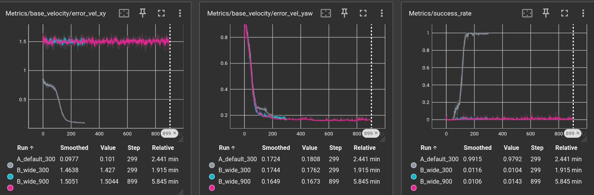
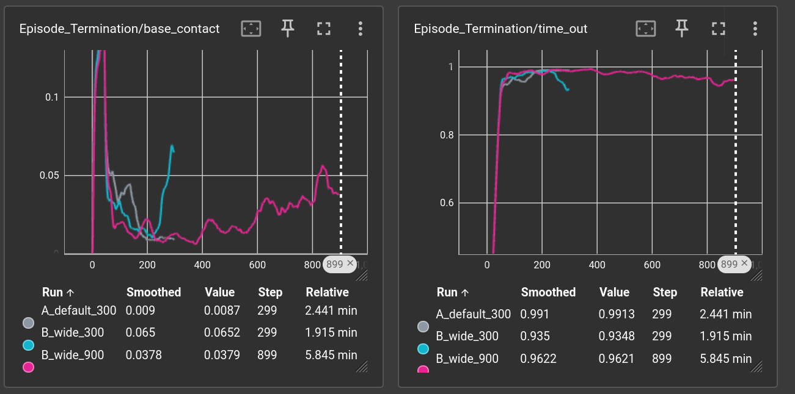

# Go2 Velocity Tracking with a Wider Command Range

## Part A: Default training
- 300 iterations (the default), checkpoint `partA/model_299.pt`
- Video: `partA/` (the robots walk and follow the velocity commands)

## Part B: Wider command range

### Change
The command ranges for the Go2 flat task are set in `source/isaaclab_tasks/isaaclab_tasks/core/velocity/velocity_env_cfg.py` (line 149, `CommandsCfg`). The Go2 configs do not override them.

| | Before | After |
|---|---|---|
| `lin_vel_x` | (-1.0, 1.0) | (-2.0, 2.0) |
| `lin_vel_y` | (-1.0, 1.0) | (-2.0, 2.0) |

`ang_vel_z` and `heading` were left unchanged. Full diff: [`partB/partB_change.diff`](partB/partB_change.diff)

### Prediction
With ±2m/s commands I expect the Go2 to fall more often for fast commands, most probably during the early training, but perhaps for the whole training as well. Since to move twice as fast, the robot would need to either make longer steps or/and increase the frequency of the steps, which makes the robot unstable.

A robot is statically stable while its center of mass sits above the support polygon, the area enclosed by the feet on the ground. At slow speeds, three or more feet are often down, so it's naturally stable. At high speeds, fewer feet touch the ground at once, and sometimes none do. The robot then depends on dynamic stability: staying upright through momentum and well-timed foot placement, which is less forgiving of mistakes. 

Although I have stated that the robot might fall throughout the training, with the increase of iterations by 3x, the robot should learn to fall less often than before. If the success rate increases by a noticable margin, the issue would be undertraining and it can likely be solved with more training.

### Runs
| Run | Command range | Iterations | Checkpoint | Video |
|---|---|---|---|---|
| A_default_300 | ±1 m/s | 300 | `partA/model_299.pt` | `partA/` |
| B_wide_300 | ±2 m/s | 300 | `partB/wide_300_model_299.pt` | `partB/wide_300.mp4` |
| B_wide_900 | ±2 m/s | 900 | `partB/wide_900_model_899.pt` | `partB/wide_900.mp4` |

### Results

| Metric | A_default_300 | B_wide_300 | B_wide_900 |
|---|---|---|---|
| `error_vel_xy` (m/s) | 0.098 | 1.464 | 1.505 |
| `error_vel_yaw` | 0.172 | 0.174 | 0.165 |
| `success_rate` | 0.992 | 0.012 | 0.011 |
| Base contact termination rate | 0.009 | 0.065 | 0.038 |
| Time-out (survived episode) | 0.991 | 0.935 | 0.962 |

Curve shapes:
- **A:** `error_vel_xy` falls from about 0.85 to 0.10, and `success_rate` rises from 0 to about 0.99.
- **B (both runs):** `error_vel_xy` stays at about 1.5 from iteration 0 to the end and never decreases.
- **Yaw:** `error_vel_yaw` converges to the same level in all three runs.

### The video description
In both the 300 iteration and 900 iteration videos, robots stop moving immediately after 2-3 seconds. Although in the second case, some robots throttle, or step continuously in the same place.

In the part A, several robots chose to step in place or stay still as well, but in part B, the proportion of the robots that chose not to move increased very vastly.

## Analysis

Falls visually did increase compared with part A, but not as much as I expected, very minor change in this regard. Instead, they stopped moving, because no matter what they did the reward, `r`, for their action was very tiny.

$$
r = \exp\left(-\frac{\lVert v_{\text{command}} - v_{\text{actual}} \rVert^2}{\sigma^2}\right), \quad \sigma^2 = 0.25 \; (\sigma = 0.5\ \text{m/s})
$$

Reward is calculated with the formula above, so it takes the gap between the commanded and actual horizontal velocity, squares it, divides by 0.25, and applies exp()

And for our error at ~1.5, the payoff is about 400x smaller. That is so small that it gets lost among the penalty terms and random noise.

Doing more iterations did not fix the issue, `error_vel_xy` and `success_rate` stayed unchanged at 900 iterations. Which proves that the issue is not undertraining. Instead we should track the reward width.

